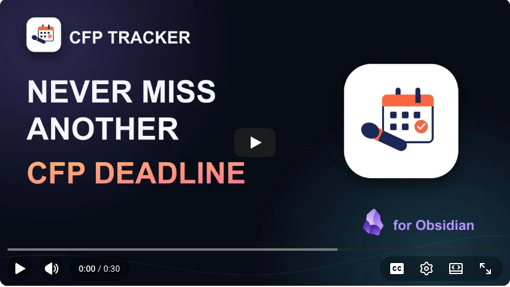
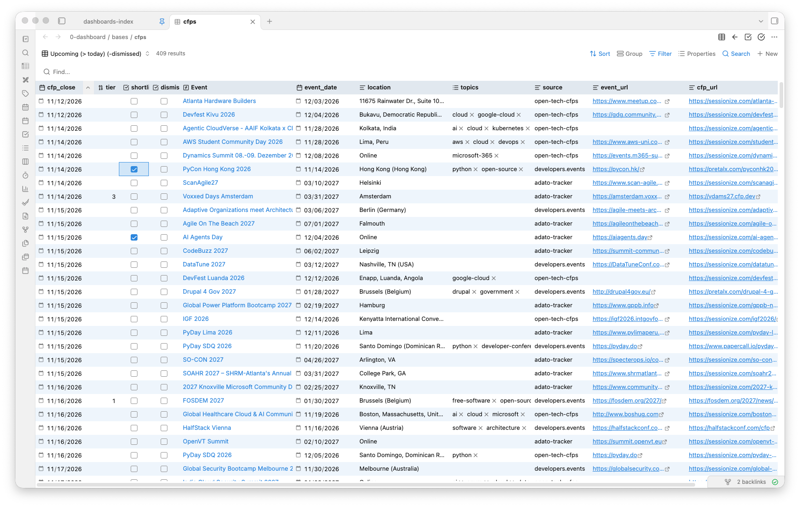
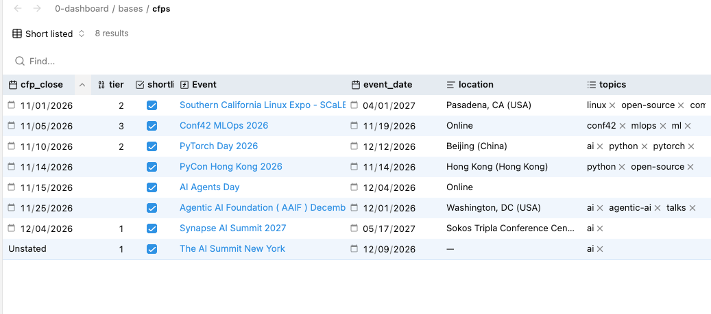
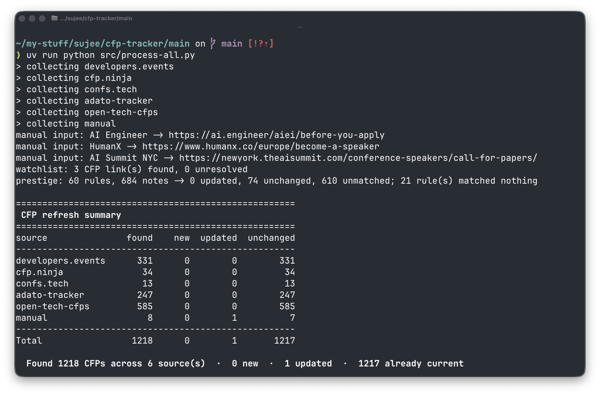

# CFP Tracker
#cfp #conference


**CFP Tracker is your personal CFP sleuth**. It collects conference Calls for Papers (CFPs) from public sources, saves them as Markdown notes, and organizes them into Obsidian Bases views.

> This is a personal tracker, not another CFP index.
> Thank you to all the CFP site maintainers whose public feeds, datasets, calendars, and CFP pages make this project possible.

**Created by [sujee.dev](https://sujee.dev/) · [Project page](https://sujee.dev/projects/cfp-tracker/) · Updates [@sujee_dev](https://x.com/sujee_dev/)**

Made with ❤️ as open source software, using [opencode](https://opencode.ai) + Kimi 3.1 Pro and DeepSeek 4.1 Flash.

## Contents

- [See it in action](#see-it-in-action)
- [Prerequisites](#prerequisites)
- [Quickstart](#quickstart)
  - [1 - Get the code](#1---get-the-code)
  - [2 - Python setup](#2---python-setup)
  - [3 - Configure (Optional)](#3---configure-optional)
  - [4 - Refresh the CFPs](#4---refresh-the-cfps)
- [CFP Markdown format](#cfp-markdown-format)
- [Browse in Obsidian](#browse-in-obsidian)
- [Typical workflow](#typical-workflow)
- [Using Agents](#using-agents)
- [Conference prestige](#conference-prestige)
- [Sources](#sources)
- [Development](#development)
- [License](#license)

## See it in action

Click a thumbnail to open the video or a full-size screenshot.

<table>
  <tr>
    <td align="center" colspan="3">
      <a href="https://youtu.be/n9_F4tn8bqM"></a>
    </td>
  </tr>
  <tr>
    <td align="center" width="33%">
      <a href="images/upcoming-1.png"></a>
      <br><b>Upcoming</b><br><sub>Open CFPs, nearest deadline first</sub>
    </td>
    <td align="center" width="33%">
      <a href="images/short-list-1.png"></a>
      <br><b>Short listed</b><br><sub>Your picks, in one view</sub>
    </td>
    <td align="center" width="33%">
      <a href="images/refresh-cfps-1.png"></a>
      <br><b>Refresh</b><br><sub>One command, per-source counts</sub>
    </td>
  </tr>
</table>

## Prerequisites

- [Python](https://www.python.org/) 3.10 or later, to fetch the CFPs.
- Git, to clone the repository.
- [Obsidian](https://obsidian.md/), to view and manage the notes. Enable the Bases core plugin.

You do not need Obsidian to refresh the CFPs. The pipeline writes plain Markdown.

Optional:

- [uv](https://docs.astral.sh/uv/), for the quickest Python setup.
- The Dataview plugin, for the dashboard.

## Quickstart

### 1 - Get the code

```bash
git clone git@github.com:sujee/cfp-tracker.git
cd cfp-tracker

# Link the note folders to your Obsidian vault.
ln -s /path/to/your-vault/cfps/data data
ln -s /path/to/your-vault/cfps/archived archived
```

### 2 - Python setup

With uv (recommended)

```bash
uv sync
```

Without uv

```
python -m venv .venv
source .venv/bin/activate
pip install -r requirements.txt
```


### 3 - Configure (Optional)

[`src/config.py`](src/config.py) contains the defaults. 

You can customize as below; only customize what you need to overwrite

```bash
cp   src/config_local.example.py    src/config_local.py  # <- gitignored
```

You can configure:

- Sources to fetch with `INPUT_SOURCES`.
- Event types to retain with `EVENT_TYPES`.
- Event names and topics to reject with `IGNORE_NAMES` and `IGNORE_TOPICS`.

See [configuration](docs/README.md#configuration)

### 4 - Refresh the CFPs!

**Option-1 (easy): Using an agent**

Open an agent in this folder. Then enter:

```text
update cfps
```

That's it!

**Option 2: To run the pipeline yourself:**

```bash
# Write notes outside the vault for an isolated check.
uv run python src/process-all.py --out /tmp/cfp-scratch --no-archive

# Refresh the notes in your vault.
uv run python src/process-all.py
```

The run prints a summary for each source. It also prints an event-type matrix.

Use `uv run python src/process-all.py --help` to see all options.


## CFP Markdown format

Fetched CFPs are saved in plain md format like below.

```md
---
type: cfp
event_name: Example Conf 2026
event_date: 2026-12-01
event_type: conference
location: Berlin, Germany
country: Germany
cfp_close: 2026-10-31
topics: [ai, cloud]
event_url: https://example.com
cfp_url: https://example.com/cfp
source: developers.events
shortlist: false
dismissed: false
submissions: []
created: 2026-11-02T00:00:00
updated: 2026-11-12T00:00:00
---

## Notes

_Add notes here._
```

See [the note format reference](docs/README.md#note-format) for every field, and for the
rules that decide which values survive a refresh.

## Browse in Obsidian

Copy [`cfps.base`](cfps.base) into your vault. Copy
[`cfps-dashboard.md`](cfps-dashboard.md) too if you want summary tables.

The base requires Obsidian Bases (included with Obsidian core). The dashboard requires the Dataview plugin.

The base reads notes from `data/`. The archive views read notes from `archived/`. If your notes use
different folders, update the paths in both files.

Personalize the location views in the `formulas` section of `cfps.base`:

- Set `my_country` to the canonical `country` value for your notes.
- Edit `is_local_area` to list your local cities and area names.

## Typical workflow:

1. Refresh the CFPs (run python fetcher)
2. Open **Upcoming** view in Obsididian base (`cfps.base`) to find open CFPs.
3. Set `shortlist: true` for interesting events.
4. Set `dismissed: true` to hide an event from live views.
5. Add wiki links to `submissions` after you submit a talk.

Most views let you include or exclude dismissed notes.

## Using Agents

Since the CFPs are saved as local markdown files, you can use an Agent to analyze them

```bash
cd   cfps
```

start your agent and ask questions like 
- `find me all AI conference CFPs`
- `find me CFPs that are due within a month`

## Conference 'prestige'

[`prestige.md`](prestige.md) assigns optional reputation tiers. Tier 1 means flagship, tier 2 means major, and tier 3 means notable. The refresh adds these tiers to matching notes.

A tier describes the conference. Your shortlist describes your interest.

```bash
# Report prestige matches without changing notes.
uv run python src/apply-prestige.py --check
```

## Sources

The pipeline reads from various sources.

See [`docs/cfp-sources.md`](docs/cfp-sources.md) for source details and attribution.

## Development

Run the tests:

```bash
uv run python -m unittest discover -s tests -v
```

Project details:

- [`docs/README.md`](docs/README.md): pipeline, note format, configuration, and commands.
- [`INSTRUCTIONS.md`](INSTRUCTIONS.md): refresh procedure and operating rules.
- [`AGENTS.md`](AGENTS.md): data shapes, configuration, and preservation rules.
- [`docs/spec.md`](docs/spec.md): historical specification from 2026-11-09.
  Use `INSTRUCTIONS.md` and `AGENTS.md` for current behavior.

## License

MIT. See [`LICENSE`](LICENSE).
